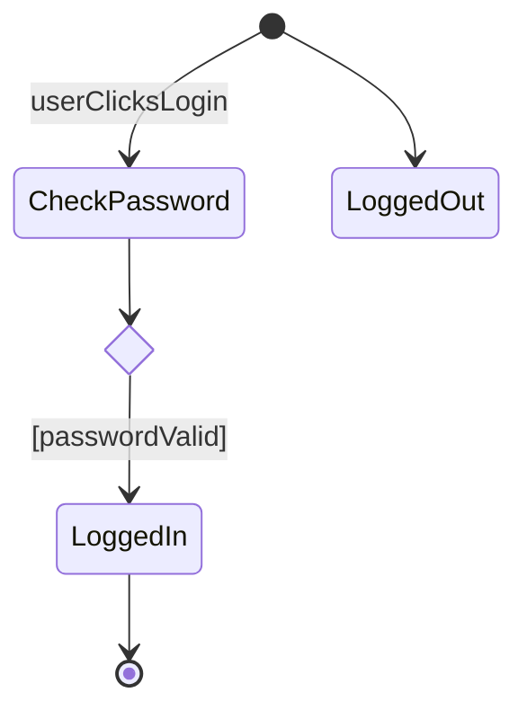
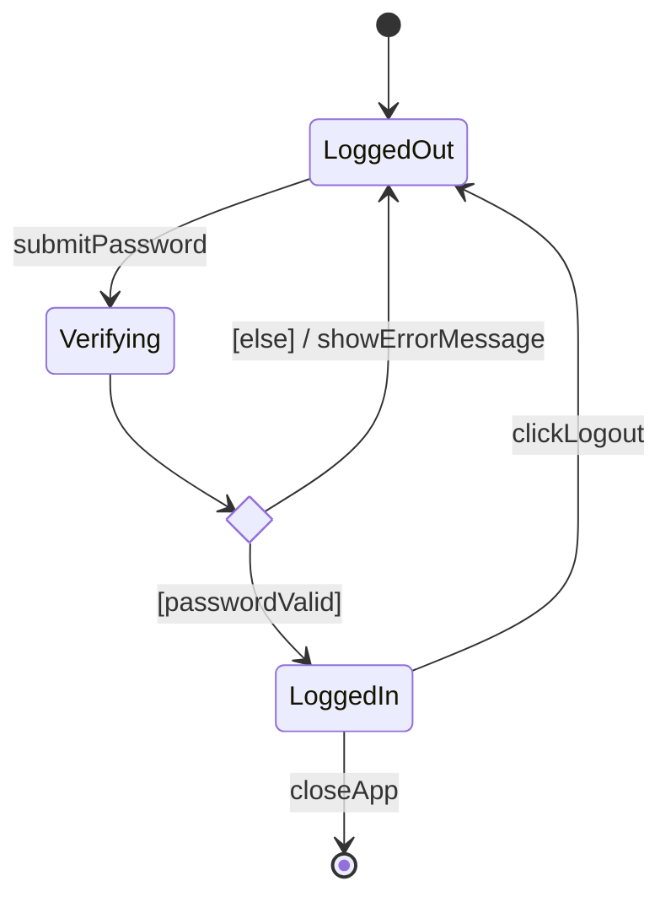

# How to Write Wonderful State Machines
*By Alessandra*

Welcome! If you have ever stared at a tangle of boxes and arrows and wondered, *"What happens if something goes wrong here?"*—this guide is for you. 

A **State Machine** is just a map of how something behaves over time. Whether you are modeling a coffee machine, a user login screen, or a video game character, a great state machine is easy to read and impossible to break.

---

## 1. The Secret to Great Diagrams: Two Simple Checks
When building your diagram (especially in tools like Modelio), think about quality in two steps:

1. **The Wiring Check (Low-Level Rules):** Are all your arrows properly connected? Just like spellcheck in a word processor, this catches accidental mistakes—like an arrow pointing to nowhere or a line leaving a `Final` state.
2. **The Logic Check (UML Rules):** Does the story actually make sense? Even if your arrows are connected properly, your system can still freeze if you forget a rule—like leaving a decision point with no fallback path.

> **Alessandra's Rule of Thumb:** Fix the wiring errors first so your tool is happy, then check the logic rules so your real-world code doesn't crash!

---

## 2. Naming Things the Right Way
Good names make your diagram readable without needing a manual.

* **States are "Being", not "Doing":** Name a state after a status or condition, not an action.
  * ✅ **Good:** `Locked`, `WaitingForPayment`, `Playing`
  * ❌ **Avoid:** `LockDoor`, `CheckPayment`, `PlayMusic`
* **Arrows are "Events & Actions":** Use the simple formula: `What happened [Condition] / What to do`
  * *Example:* `buttonPressed [hasCoins] / dispenseCoffee`

---

## 3. Five Golden Rules to Avoid Logic Traps

### Rule 1: Every journey needs one clear starting line
Put **one** `Initial` state (the solid black circle) in your diagram. Never put conditions or triggers on the arrow leaving it—your system needs to start immediately without waiting for permission.

### Rule 2: Never leave a decision without a backup plan (`[else]`)
Whenever you use a `Choice` diamond to make a decision, **always include an `[else]` arrow**. 
* *Why?* If none of your conditions are true and there is no `[else]` path, your system gets stuck forever in limbo.

### Rule 3: Keep parallel paths balanced
If your system needs to do two things at the exact same time, use a **Fork** bar to split the path and a **Join** bar to bring them back together. Never draw a shortcut arrow directly between two parallel boxes—always go through the bars.

### Rule 4: Don't exit a room just to walk back in
If an event happens while you are in a state, and you want to stay in that exact same state without restarting it, use an **Internal Transition** instead of drawing a loop arrow back to the outside of the box.

### Rule 5: When a diagram gets crowded, group things up
If you have more than 7 or 8 boxes on screen, your diagram is getting hard to read. Group related states inside one bigger box (a **Composite State**) to keep the big picture clean.

---

## 4. Good vs. Bad Example: A Simple Login Screen
Let's put these rules to work with a real example: **a user trying to log in with a password.**

### ❌ The "Bad" State Machine (4 Classic Mistakes)

**Why this fails in real life:**
1. **Two starting points:** There are two `Initial` (`[*]`) circles! The system doesn't know where to begin.
2. **A gated start:** The arrow leaving the top `Initial` circle has a trigger (`userClicksLogin`). Initial transitions must happen automatically.
3. **A deadly trap at the Choice diamond:** If `[passwordValid]` is false, there is **no `[else]` arrow**. The login screen completely freezes!
4. **Action-based state name:** `CheckPassword` sounds like a function, not a state of being.

---

### ✅ The "Wonderful" State Machine (Clean & Safe)

**Why this works like a charm:**
1. **One clean start:** The system immediately starts in `LoggedOut` with no conditions blocking it.
2. **Clear state names:** `LoggedOut`, `Verifying`, and `LoggedIn` describe *statuses*, not actions.
3. **Bulletproof decision:** The `Choice` diamond has an `[else]` path that shows an error message and safely returns the user to `LoggedOut`.
4. **Complete lifecycle:** Users can log out and try again, or close the app cleanly to reach the `Final` state.

---

## 5. Make It Pretty (Visual Tips)
* **Pick one flow direction:** Start at the top-left and flow down or to the right. Avoid making readers zigzag across the screen.
* **Untangle your lines:** Rearrange your boxes so arrows don't cross over each other like spaghetti.
* **Highlight the "Happy Path":** Keep the normal, everyday flow straight and obvious, and tuck error paths neatly off to the side.

---

## 6. Alessandra's Pre-Flight Checklist
Before you call your State Machine "done," ask yourself these 5 questions:

- [ ] **Zero tool errors:** Did I run the model audit (like Modelio's Audit view) and fix all broken arrow errors (such as `E233`)?
- [ ] **No dead ends:** Can every state eventually move forward or reach a `Final` state?
- [ ] **No trapped choices:** Does every `Choice` diamond have an `[else]` exit?
- [ ] **Clean start & finish:** Does my `Initial` circle have zero incoming arrows, and my `Final` bullseye have zero outgoing arrows?
- [ ] **The 10-second test:** If I show this to a teammate, can they understand what it does in 10 seconds?
